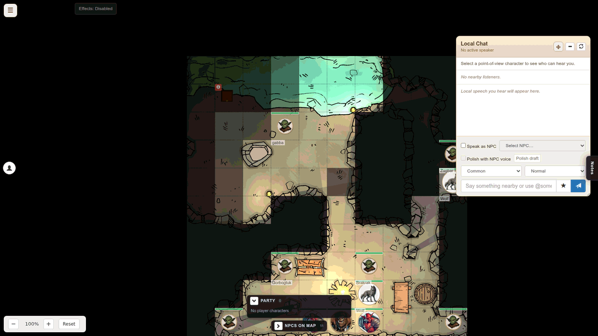
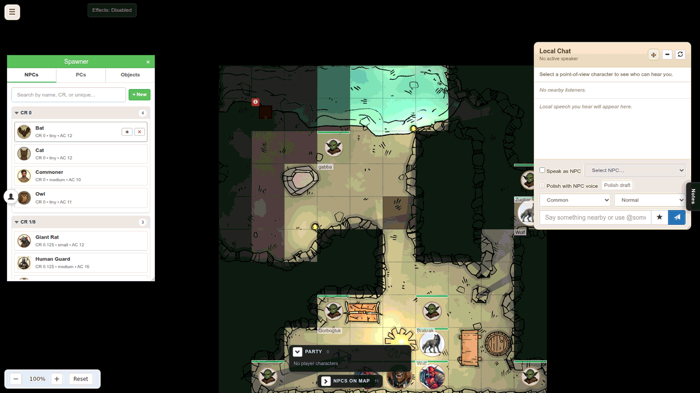
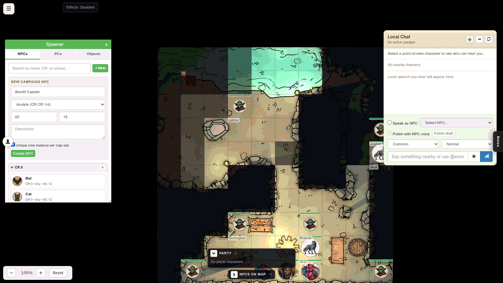
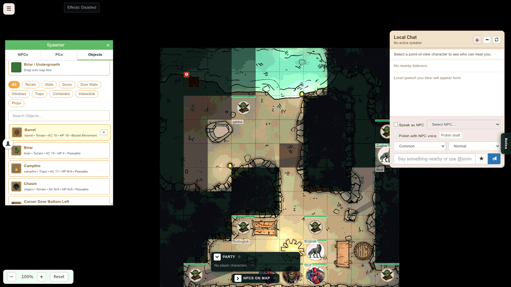
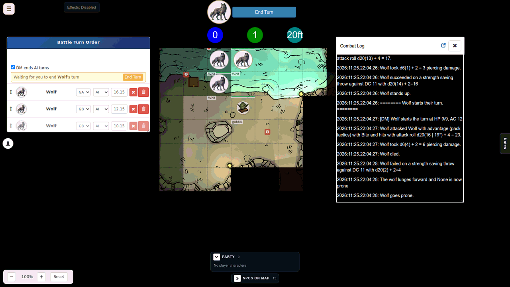
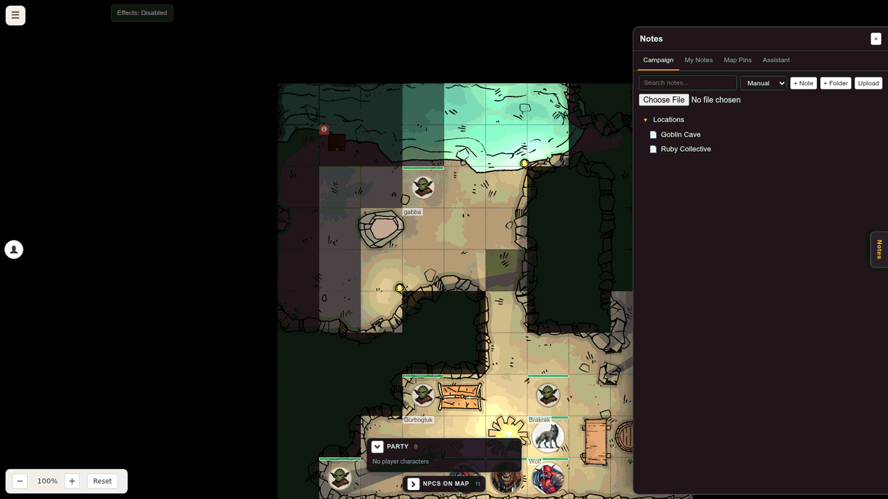
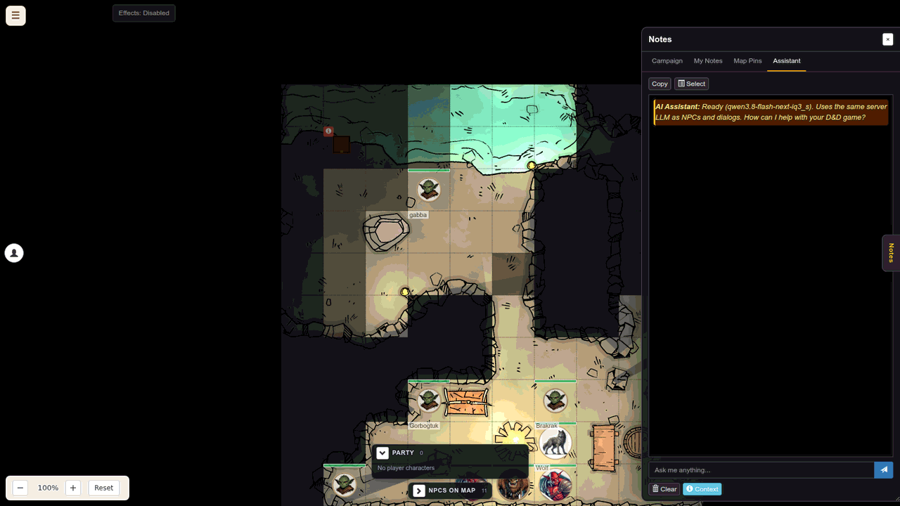
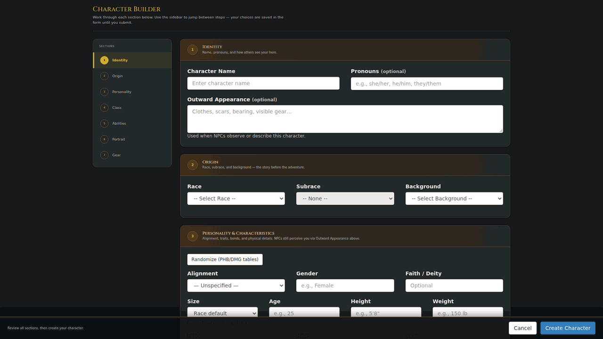
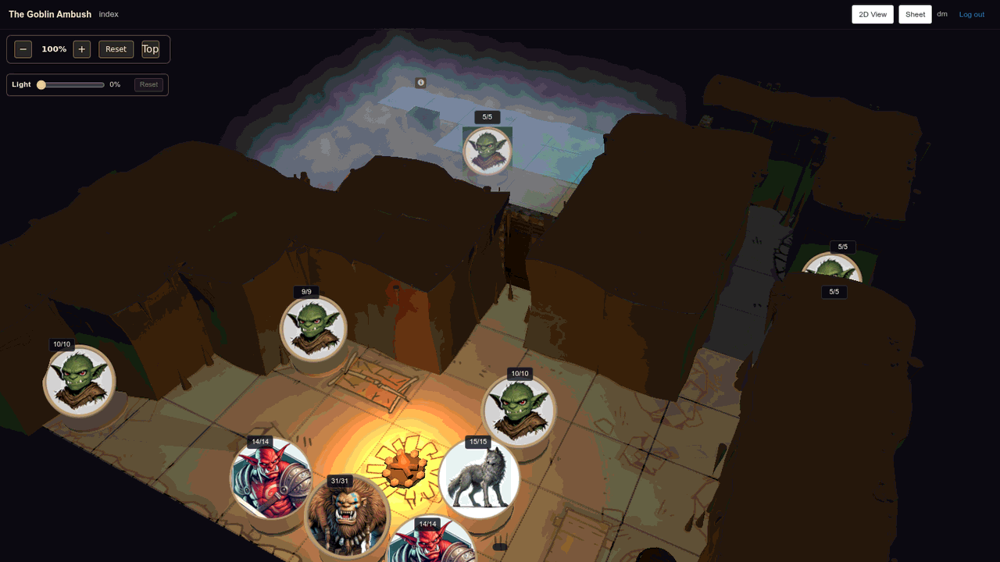

# n20-webapp — Natural 20 VTT (Flask + SocketIO)

Flask virtual tabletop that drives the [`natural20`](../natural_20.py) engine.

This repository is **standalone**: it does not vendor the engine or campaign data.

```bash
# 1. Engine (SRD templates + simulation core) — clone next to this repo and install
git clone https://github.com/jedld/natural_20.py.git ../natural_20.py
pip install -e ../natural_20.py

# 2. Webapp
pip install -e ".[dev]"
npm install

# 3. Local config (LLM providers etc.)
cp webapp/env.example webapp/.env   # then edit provider URLs/models
```

`natural20` is **not on PyPI** — the webapp's `natural20>=0.1.0` dependency must
be satisfied by an engine checkout (`pip install -e ../natural_20.py`) or a git
URL (`pip install "natural20 @ git+https://github.com/jedld/natural_20.py.git@master"`).

## Screenshots

Shown against the bundled template campaign (SRD-only content).

**The DM table** — server-rendered map with fog of war, token portraits, the
on-map NPC tray, and local (in-world) chat:



| Campaign spawner: NPC types grouped by CR — hover a row for its actions: mark unique (★), delete from the campaign (✕); unique NPCs also get Duplicate (⧉) | Creating a new campaign NPC type from a bundled base |
|---|---|
|  |  |

| Objects and terrain palette, with the new-object form | Combat: initiative order, per-combatant group/controller, DM pacing, combat log |
|---|---|
|  |  |

| Campaign notebook (notes, folders, uploads, map pins) | DM AI assistant dock |
|---|---|
|  |  |

| Character builder (opened by the PC tray's **+ New**) | Three.js tabletop client (`/3d`) |
|---|---|
|  |  |

Regenerate them against a running server:

```bash
./start_web.sh                                    # or any campaign you like
pip install playwright && playwright install chromium
python scripts/capture_readme_screenshots.py      # -> docs/screenshots/*.png
```

## Campaign data

Campaigns live in a separate repository (for example `n20-campaigns`). Point the
webapp at a campaign directory with `TEMPLATE_DIR` or `N20_CAMPAIGNS_DIR`:

```bash
export N20_CAMPAIGNS_DIR=../n20-campaigns
./start_web.sh wild_sheep_chase
# equivalent:
# TEMPLATE_DIR=../n20-campaigns/wild_sheep_chase ./start_web.sh
```

Bundled SRD YAML (spells, items, classes) ships with the **engine** package under
`templates/` and is merged automatically when a campaign file inherits from SRD.

## Run (development)

```bash
./start_web.sh [--edit] [--reset] [campaign_slug_or_path]
```

Defaults to `../natural_20.py/templates` (engine checkout) when no campaign is passed.
Flags may appear before or after the campaign argument:

- `--edit` — after a DM logs in, that session starts in campaign edit mode.
- `--reset` — wipe persisted save state at boot: `save_*.yml[.gz]`,
  `last_save.txt`, per-save log/read-notes snapshots, `campaign_logs.sqlite`,
  `notebook.sqlite` + `notebook_files/` (under `SAVE_DIR/<game>/`), and NPC
  memory files (`<campaign>/npc_memories/*.json`). The campaign then boots
  from YAML templates with no saves to autoload. Also settable via
  `N20_RESET_SAVES=1`.

Production:

```bash
N20_USE_GUNICORN=1 ./start_web.sh ../n20-campaigns/wild_sheep_chase
```

## Tests

Many webapp tests load campaign data from `user_levels/` (checked out at the
repo root or a sibling directory — this is what CI does), so the campaigns
repo is needed for the full suite:

```bash
git clone <n20-campaigns-url> user_levels        # inside this repo, or:
export N20_CAMPAIGNS_DIR=/path/to/n20-campaigns  # ... or point at a checkout

export TEMPLATE_DIR=../natural_20.py/templates
pytest tests/webapp -q
npm test
```

## Docker

The image installs the engine from GitHub at build time; override the source
with `--build-arg NATURAL20_ENGINE_REF=git+https://.../natural_20.py.git@ref`.

```bash
cp webapp/env.example webapp/.env   # edit providers first
docker build -t n20-webapp .
docker run --env-file webapp/.env \
  -e TEMPLATE_DIR=/campaigns/wild_sheep_chase \
  -v /path/to/n20-campaigns:/campaigns:ro \
  -p 5001:5001 n20-webapp
```

## Layout

| Path | Purpose |
|------|---------|
| `webapp/` | Flask app, blueprints, static assets, Jinja templates |
| `tests/webapp/` | HTTP/SocketIO parity tests |
| `scripts/minify.mjs` | JS asset pipeline (`npm run build:assets`) |
| `scripts/capture_readme_screenshots.py` | Playwright capture of the README screenshots (`docs/screenshots/`) |

See also: [Repository split guide](https://github.com/jedld/natural_20.py/blob/master/docs/REPOSITORY_SPLIT.md) in the engine repo.

## Production deploy

Set these before serving beyond localhost (see `webapp/env.example`):

- `N20_SECRET_KEY` — session signing key (`openssl rand -hex 32`). If unset a
  random key is generated per process, which is safe but ends sessions on
  every restart. Never commit a key.
- `CORS_ORIGINS` — comma-separated list of your public origins. The default
  only allows localhost and ngrok tunnels; wildcards are not enabled by
  default because CORS runs with credentials.
- `FLASK_ENV=production` (or `N20_USE_MINIFIED_ASSETS=1`) to serve the
  minified JS/CSS built by `npm run build:assets`.

## License & attribution

- Code in this repository is MIT licensed — see [`LICENSE.md`](LICENSE.md).
- Game statistics and rules text follow the **System Reference Document 5.2.1**
  (CC BY 4.0); the engine repository carries the full notice in
  [`docs/ATTRIBUTION_SRD.md`](https://github.com/jedld/natural_20.py/blob/master/docs/ATTRIBUTION_SRD.md).
- Icons include **Font Awesome Free 6** (icons CC BY 4.0, fonts SIL OFL 1.1,
  code MIT, Copyright Fonticons Inc.) and **Bootstrap**/**jQuery**/**Socket.IO**
  (MIT); headers ship with the bundled files under `webapp/static/libs/`.
- VTT art assets were generated for this project.
- *Dungeons & Dragons, D&D and related marks are trademarks of Wizards of the
  Coast LLC. This project is not affiliated with, endorsed by, or sponsored by
  Wizards of the Coast.*
